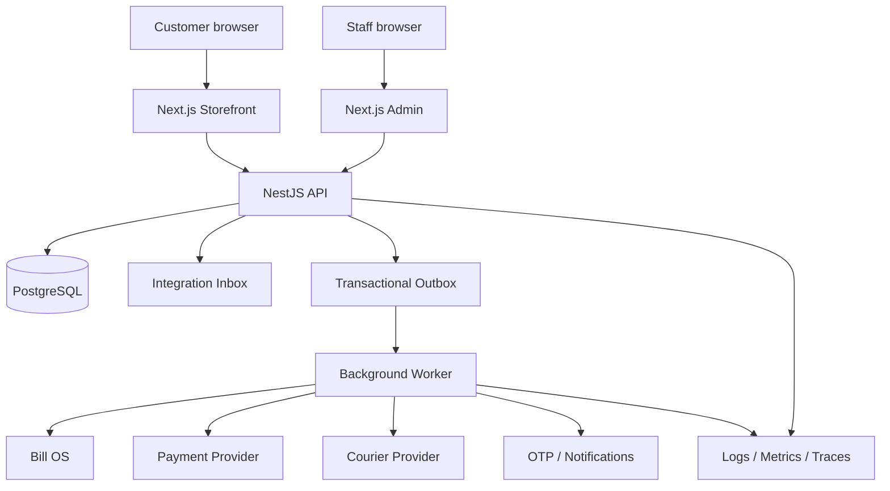

# Target System Architecture

## Principles

- Modular monolith first: one transactional API/database boundary; do not split services without measured need.
- Explicit domain ownership: modules expose use cases; other modules do not write their tables directly.
- Database transactions protect business invariants.
- External effects use durable outbox/inbox, idempotency, retries and reconciliation.
- API is the trust boundary; recalculate all financial and inventory decisions server-side.
- Evolve with backwards-compatible expand/migrate/contract changes.
- Instrument requests, jobs and integrations with correlation IDs and safe structured logs.

## Logical topology



This is the target logical design, not a claim that each worker/adapter already exists. A worker can initially be another process in this monorepo and use the same domain code/database.

## Repository boundaries

| Area | Owns | Must not own |
|---|---|---|
| `apps/api` | HTTP, guards, use-case orchestration, persistence adapters, worker entrypoints | UI state or provider-specific business rules inside controllers |
| `apps/web` | Customer browse, cart, checkout UI, account, tracking, returns | Authoritative price, stock, tax or payment state |
| `apps/admin` | Staff operations and dashboards | Authorization decisions or direct DB access |
| `packages/validation` | Shared request/event contracts | Persistence and network side effects |
| `packages/inventory-core` | Pure inventory rules/calculations | Hidden DB/network access |
| `packages/design-tokens` | Visual foundations | Business logic |

Map actual paths before implementation. Keep transport DTOs, domain concepts and Prisma models separate where this prevents coupling.

## Bounded contexts

Identity/access; catalogue; pricing/promotions; inventory; checkout/orders; payments; fulfilment; returns/exchanges; tax/documents; customer/CRM; Bill OS/store operations; notifications; admin/audit; platform operations.

Use existing modules where possible. Do not rename modules mechanically.

## Dependency direction

```text
Controllers / Workers
        -> Application use cases
             -> Domain policies and value objects
             -> Ports (repositories, payment, courier, messaging, Bill OS)
Infrastructure adapters implement ports:
Prisma, HTTP clients, provider SDKs, queue/outbox workers
```

Domain code must not import NestJS, Next.js, Prisma or provider SDKs. Controllers validate/authenticate/authorize, invoke a use case and map a response.

## Critical flows

### Checkout
1. Authenticate customer or establish scoped guest identity.
2. Load authoritative SKU, price, discounts and stock.
3. Verify pincode serviceability, shipping and COD eligibility.
4. Calculate line totals, discount, shipping, tax and payable in integer paise.
5. In one transaction create order and immutable item/price/tax snapshots, reserve stock, record movement/reservation, store idempotency result and append outbox events.
6. Commit before calling external services.
7. Create payment intent/session idempotently outside the order transaction.
8. If provider result is uncertain, reconcile before retry.

### Payment webhook
Verify signature over raw body; persist provider event ID with unique constraint; validate order/currency/amount; apply monotonic state transition transactionally. Duplicate events are harmless. Browser redirects are not proof of payment.

### Inventory
All mutations use one ledger path. Movement includes SKU, location, signed quantity, reason, actor/system, correlation ID and idempotency key. Guarded updates/locks prevent negative available stock. Persist movement and balance atomically. Reconciliation reports drift; it never silently overwrites history.

### Returns
Separate authorization, physical receipt, inspection, disposition and refund. Lock returnable quantity; restock only newly received accepted quantity; link one unique stock movement per restock. Exchange is incomplete until replacement fulfilment and price difference are represented.

## API conventions

- Preserve current version prefix conventions; audit observed `/v1` health routes, verify before changing.
- Validate body/query/headers/webhooks with shared schemas.
- Use stable safe error envelopes with code, request ID and field errors.
- Cursor paginate large lists; cap page size.
- Use explicit response DTOs; never serialize Prisma records blindly.
- Require idempotency keys for order, payment session, refund, shipment, return receipt and integration commands.
- Use optimistic concurrency or locks for competing admin edits.
- Add fields before removing/renaming old API fields.

## Frontend and cache

Storefront and admin are API clients. Revalidate every checkout input on the server. Prefer HttpOnly Secure SameSite cookies with CSRF protection or a BFF/session architecture over JS-readable bearer tokens. Cache public catalogue/content only where staleness is acceptable; never use cache as authority for stock, payment, refunds, permissions or order ownership.

## Background work

Use durable DB-backed jobs/outbox. Each job needs stable ID, event type/schema version, aggregate reference, idempotency key, correlation ID, attempts, next retry, completion and quarantine state. Use lease/claim semantics for multiple workers. Retry transient errors with exponential backoff and jitter; do not retry permanent failures indefinitely.

## Scale

Start with API, worker and managed PostgreSQL with connection pooling. Scale web/admin independently. Add Redis only for shared rate limits, coordination or cache; not as a replacement for durable transactional records. Extract services only after measuring a bottleneck and documenting ownership.
